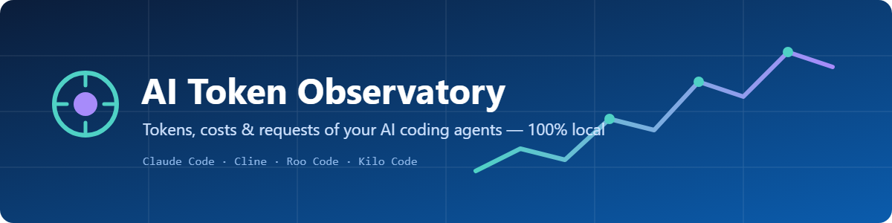
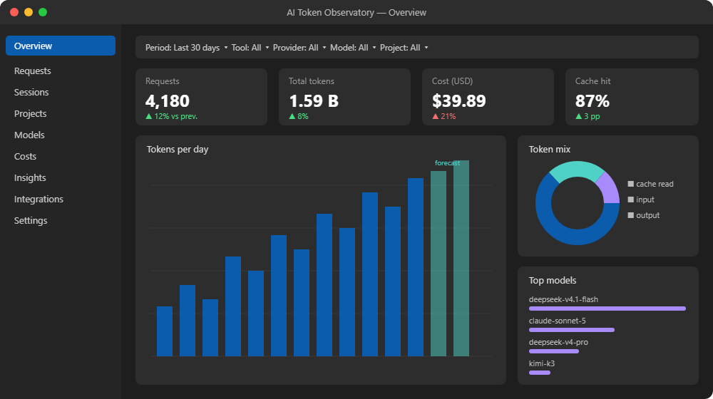
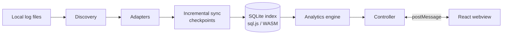

<p align="center">
  
</p>

<p align="center">
  <b>See exactly how many tokens — and dollars — your AI coding agents burn.</b><br>
  Local-first observability for <b>Claude Code</b>, <b>Cline</b>, <b>Roo Code</b> and <b>Kilo Code</b>, right inside VS Code.
</p>

<p align="center">
  
  
  
  
  
  
</p>

<p align="center">
  <a href="#-features">Features</a> •
  <a href="#-installation">Installation</a> •
  <a href="#-supported-tools">Supported tools</a> •
  <a href="#-how-costs-are-calculated">Costs</a> •
  <a href="#-privacy">Privacy</a> •
  <a href="#-development">Development</a>
</p>

---

<p align="center">
  
  <br><sub><i>Illustrative mockup of the Overview page.</i></sub>
</p>

## ✨ Why

AI agents are great — until the bill arrives. Each tool keeps its own logs in its own format, and none of them shows the full picture.
**AI Token Observatory** reads the files those tools already write to disk, indexes only the usage numbers, and gives you one dashboard for all of them.

- 🔌 **Zero setup** — no API keys, no account, no proxy.
- 🏠 **100% local** — no network calls, no telemetry.
- 🎯 **Honest numbers** — unknown values stay unknown; costs are never invented.

## 🚀 Features

| | |
|---|---|
| 📊 **Overview** | KPIs with period-over-period comparison, daily series, token mix, top models, monthly forecast |
| 📋 **Requests** | Sortable / searchable table, configurable columns, detail drawer per request |
| 🧵 **Sessions** | Session list with per-request timeline |
| 📁 **Projects · Models · Costs** | Breakdown by any dimension; cost split into reported / estimated / unknown |
| 💡 **Insights** | Robust anomaly detection (median/MAD), spikes, outlier sessions, cache efficiency, peak hours |
| 🔌 **Integrations** | Health of every detected source: files, requests, errors, known limitations |
| 🎛️ **Global filters** | Period, tool, provider, model, project, session — click any chart to drill down |
| 📤 **Export** | CSV / JSON (formula-injection safe, paths excluded unless requested) |
| 📍 **Status bar** | Live cost of the active session |

Under the hood: incremental sync (file watchers + polling), per-file checkpoints, deduplication, and recovery from partial or truncated files.

## 📦 Installation

```powershell
code --install-extension ai-token-observatory.vsix
```

Then reload the window and click the **AI Token Observatory** icon in the Activity Bar. The first sync runs automatically.

| Command (`Ctrl+Shift+P`) | What it does |
|---|---|
| `AI Token Observatory: Open Dashboard` | Opens the dashboard |
| `AI Token Observatory: Rescan Sources` | Re-discovers tool folders |
| `AI Token Observatory: Refresh Data` | Forces an incremental sync |
| `AI Token Observatory: Export Report` | Exports requests as CSV or JSON |
| `AI Token Observatory: Show Diagnostics` | Shows source health and read errors |

## 🧩 Supported tools

| Tool | Where data is read from | Unit of record |
|---|---|---|
| **Claude Code** | `~/.claude/projects/**/*.jsonl` (or `CLAUDE_CONFIG_DIR`) | assistant message (dedup by `message.id:requestId`) |
| **Cline** (legacy) | `globalStorage/saoudrizwan.claude-dev/tasks` | completed `api_req_started` |
| **Cline** (v2) | `~/.cline/data/sessions/*/*.messages.json` | per-message metrics |
| **Roo Code** | `globalStorage/rooveterinaryinc.roo-cline/tasks` | completed `api_req_started` |
| **Kilo Code** | `globalStorage/kilocode.kilo-code/tasks` | completed `api_req_started` |

`globalStorage` is searched for VS Code, Insiders, VSCodium, Cursor and Windsurf. Extra folders can be added via settings.

## 🏗️ Architecture



## 💰 How costs are calculated

| Priority | Basis | When |
|---|---|---|
| 1 | **Reported** | The tool recorded the cost (Cline / Roo / Kilo). A reported `0` stays `0`. |
| 2 | **Estimated** | Model is in the versioned price table (`v1-2026-01`) or in your `customPricing`. Ollama / LM Studio = `0`. |
| 3 | **Unknown** | No reliable data — shown as unknown, **never invented**. |

> [!NOTE]
> Claude Code subscription usage is shown as an **API-equivalent estimate**, not actual billing. Local logs never contain the real billed amount.

**Total tokens** = input + output + cache read + cache write + reasoning (missing fields are unknown, not zero).

## 🔒 Privacy

- Only usage fields are indexed (SQLite in VS Code global storage) — **prompts and responses are never stored**.
- Optional content preview is **off by default** and reads directly from the source, only inside known folders.
- Strict Content Security Policy with nonce in the webview; no external scripts.
- Secret files (e.g. `secrets.json`) are never read. No network calls, no telemetry.

## ⚙️ Settings

| Key (`aiTokenObservatory.*`) | Default | Description |
|---|---|---|
| `refreshIntervalSeconds` | `30` | Polling interval (complements file watchers) |
| `manualSourceFolders` | `[]` | Extra folders to scan |
| `showStatusBar` | `true` | Show active-session cost in the status bar |
| `allowContentPreview` | `false` | Allow on-demand preview of original content |
| `brlRate` / `brlRateDate` | `0` / `""` | Optional USD→BRL rate |
| `customPricing` | `{}` | USD per million tokens per model |

```json
"aiTokenObservatory.customPricing": {
  "my-model": { "input": 3, "output": 15, "cacheRead": 0.3, "cacheWrite": 3.75 }
}
```

## ⚠️ Limitations
- Claude Code logs no request duration; Cline/Roo duration is approximated from the next UI message.
- Cline/Roo model may be inferred from task metadata when not on the request.
- Kilo Code support is based on the shared Roo/Cline task layout (validated with fixtures only).
- Pricing table must be updated as vendors change prices; use custom pricing for other models.

## 🛠️ Development

```powershell
npm install
npm run typecheck        # tsc --noEmit
npm test                 # vitest
npm run build            # dist/extension.js, dist/sql-wasm.wasm, dist/webview/*
npx @vscode/vsce package --no-dependencies --out ai-token-observatory.vsix
```

Press <kbd>F5</kbd> to launch the Extension Development Host.

**Tech stack:** TypeScript · esbuild · sql.js (WASM) · React 18 · Zustand · Tailwind CSS · ECharts · Vite · Vitest

## 🤝 Contributing

Contributions are welcome! See [CONTRIBUTING.md](CONTRIBUTING.md) — including how to add a new source adapter. Changes are tracked in [CHANGELOG.md](CHANGELOG.md).

## 📄 License

[MIT](LICENSE) © AI Token Observatory contributors
